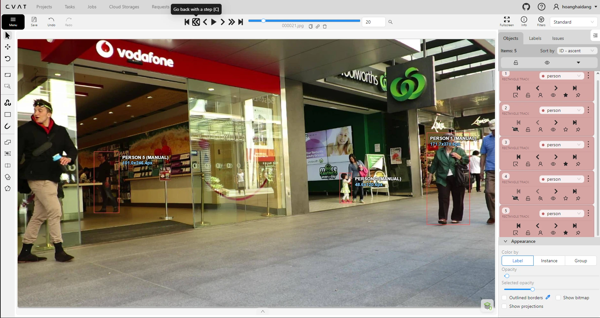
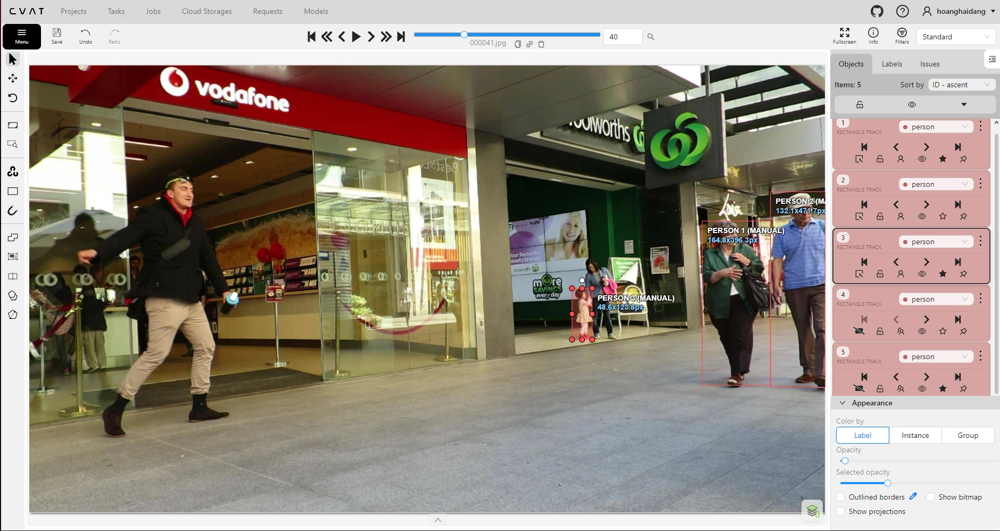
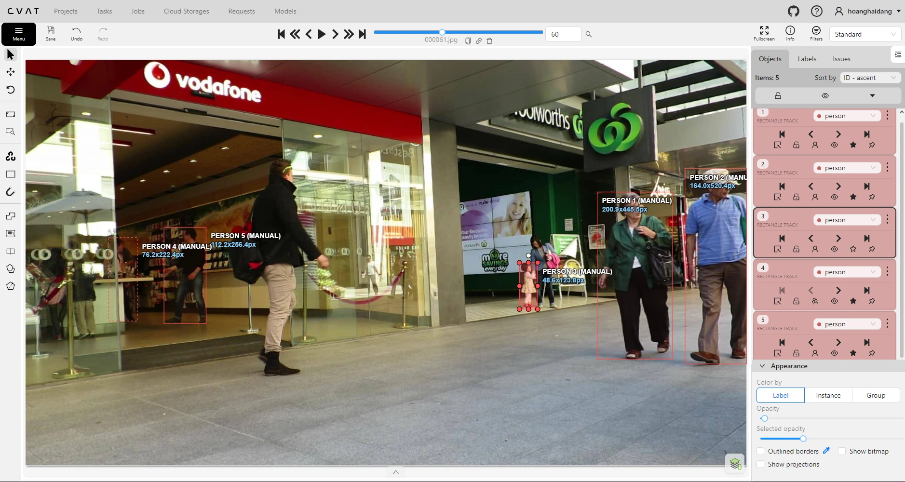

# Báo cáo cá nhân — HoangHaiDang-2A202603189

Đoạn video: MOT17-09, 150 frame (frame 1–150), nguồn MOTChallenge, giấy phép CC BY-NC-SA 3.0.

Trong báo cáo, số frame ghi theo CVAT (0–149). Trong `gt.txt`, frame_id = frame CVAT + 1.

## 0. Thông tin học viên

- Họ tên: **Hoàng Hải Đăng**
- MSSV: **2A202603189**
- Mã đề (A/B/C): **A**
- Email: **26ai.danghh2@vinuni.edu.vn**
- Link repository: **https://github.com/hoanghaidang1233/K5-L2-DAY5-HoangHaiDang-2A202603189-MOTTracking**
- Giờ bắt đầu: 16h30
- Giờ kết thúc: 18h30

## 1. Xem trước đoạn video (CP0)

Ghi **trước khi vẽ**, mỗi người một dòng.

| Mã | Frame xuất hiện | Frame cuối thấy được | Rẽ / dừng / đổi tốc độ ở frame | Bị che ở frame | Ghi chú |
|---|---|---|---|---|---|
| P1 | 0 | 149 | Đi sang phải 0–39; sau khi hiện lại (60) tiếp tục sang phải, chậm dần quanh 100–110, rồi lùi nhẹ sang trái 120–149 | 30–39 che một phần, 40–59 khuất hẳn | Người được chọn cho bài che khuất |
| P2 | 60 | 149 | Đi sang phải 60–110, đứng lại 110–120, đổi hướng sang trái 120–149 | 60–69 che một phần lúc mới xuất hiện | Xuất hiện ở bên trái khung, gần chỗ P1 bị che |
| P3 | 0 | 149 | Đi sang trái và lại gần camera suốt đoạn, đi nhanh hơn từ khoảng 110 | Không | Box cao dần từ khoảng 340 px lên 840 px |
| P4 | 39 | 149 | Vào từ mép phải ở 39, đi sang trái và lại gần camera | Không (bị mép khung cắt lúc mới vào) | Box cao dần từ khoảng 470 px lên 950 px |
| P5 | 0 | 109 | Đi chậm sang phải 0–30, gần như đứng yên 30–109 | Không | Ở xa camera, box nhỏ; không còn thấy từ frame 110 nên bật `outside` |

## 2. Keyframe và thời gian (CP1, CP4)

Số keyframe lấy từ kết quả `src/check_submission.py`.

| Mã | Số keyframe | Keyframe ở frame | Số frame có mặt | Keyframe / 100 frame | Thời gian (phút) | Chỗ khó |
|---|---|---|---|---|---|---|
| P1 | 14 | 0, 10, 20, 30, 60, 70, 80, 90, 100, 110, 120, 130, 140, 149 | 130 | 10.8 |15 | |
| P2 | 10 | 60, 70, 80, 90, 100, 110, 120, 130, 140, 149 | 90 | 11.1 |15 | |
| P3 | 16 | 0, 10, 20, 30, 40, 50, 60, 70, 80, 90, 100, 110, 120, 130, 140, 149 | 150 | 10.7 |15 | |
| P4 | 12 | 39, 50, 60, 70, 80, 90, 100, 110, 120, 130, 140, 149 | 111 | 10.8 |15 | |
| P5 | 6 | 0, 10, 20, 30, 40, 50 | 110 | 5.5 |15 | |
| **Tổng** | **58** | | **591** | **9.8** |75 | |

Keyframe / 100 frame của cả bài = tổng keyframe ÷ tổng số frame có mặt × 100 = 58 ÷ 591 × 100 = **9.8**

Bạn đặt keyframe nhiều nhất ở người nào? Vì sao (người đó rẽ, dừng, lại gần camera hay bị che)?

Nhiều nhất là **P3 (16 keyframe)**. P3 có mặt đủ 150 frame và đi lại gần camera suốt đoạn, nên box liên tục to ra (cao khoảng 340 px lên 840 px) và nội suy tuyến tính không theo kịp. Vì vậy box phải chỉnh lại ở mỗi lần nhảy 10 frame. Ít nhất là **P5 (6 keyframe)**, vì P5 gần như đứng yên từ frame 30 đến 109, nội suy giữa hai box giống nhau vẫn đúng.

## 3. Đoạn bị che (CP2)

Người bị che: `P5`

| Mốc | Frame |
|---|---:|
| Bắt đầu bị che một phần (bật `occluded`) | 30 |
| Mất hẳn (bật `outside`) | 40 |
| Hiện lại (tắt `outside`) | 60 |
| Thấy rõ trở lại (tắt `occluded`) | 60 |

- Thời gian khuất hẳn: **20 frame = 0,67 giây** (frame 40–60).
- Quyết định: **giữ cùng ID**.
- Lý do: khuất bao lâu so với 60 frame, ngoại hình có khớp, chỗ hiện lại có đúng hướng và tốc độ:

1. P5 khuất 20 frame, ít hơn ngưỡng 60 frame (2 giây) của lớp.
2. Ngoại hình: quần áo, dáng người trước và sau đoạn che có khớp với nhau
3. Hướng và tốc độ khớp: trước khi che, P1 đi sang phải với tâm box từ x ≈ 302 (frame 0) đến x ≈ 370 (frame 30), khoảng 2,3 px/frame. Khi hiện lại ở frame 60, tâm box ở x ≈ 424, vẫn ở bên phải chỗ biến mất và đúng hướng đi, tốc độ trung bình khoảng 1,8 px/frame.

Ảnh chụp màn hình (P1 hiển thị trong CVAT dưới tên object **"PERSON 5"**, panel item thứ 5, đúng theo bảng đối chiếu ở mục 5):





Nguồn ảnh: MOT17, MOTChallenge (Milan et al., 2016).

## 4. Tự review ID (CP3)

Lượt 1 theo người (đi ngược từ frame 149 về 0 trên CVAT), lượt 2 theo cảnh (nhảy 10 frame). Ít nhất 3 dòng; không có lỗi thì ghi một dòng "đã kiểm hai lượt, không lỗi".

Loại lỗi dùng đúng một trong 7 mã: `id_switch`, `fragmentation`, `lost`, `merge`, `false_track`, `drift`, `flag`.

| Frame | Mã người | Loại lỗi | Mô tả một câu | Phát hiện ở lượt | Đã sửa? |
|---:|---|---|---|---|---|
| - | - | - | Đã kiểm hai lượt, không lỗi | Lượt 1 và lượt 2 | - |

Tổng hợp số lỗi theo loại:

| `id_switch` | `fragmentation` | `lost` | `merge` | `false_track` | `drift` | `flag` |
|---:|---:|---:|---:|---:|---:|---:|
| 0 | 0 | 0 | 0 | 0 | 0 | 0 |

Lỗi nào chỉ lượt 2 (theo cảnh) mới thấy, lượt 1 (theo người) không thấy? Vì sao?

Không có, vì cả hai lượt đều không phát hiện lỗi nào.
## 5. File xuất và kết quả tự kiểm (CP4)

| Kiểm tra | Kết quả |
|---|---|
| Tên file MOT 1.1 | `src/exports/HoangHaiDang_mot.zip` |
| Tên file CVAT for video 1.1 | `src/exports/HoangHaiDang_cvat_video.zip` |
| Số track ID khác nhau trong `gt/gt.txt` (phải là 5) | 5 |
| Frame `outside` không có dòng trong `gt.txt` (đúng / sai) | Đúng: ID 3 (P1) không có dòng nào ở frame_id 41–60 (frame CVAT 40–59) |
| Job đã completed trên CVAT máy cá nhân | Có |

Dán phần tóm tắt in ra từ `src/check_submission.py`:

```text
=== File MOT 1.1: HoangHaiDang_mot.zip ===
  Số track ID: 5   |   Tổng số box: 591
  [OK]        Đúng 5 track ID.

  Track | Frame có mặt | Số frame | Đoạn vắng (outside)
      1 |   0–149      |      150 | -
      2 |   0–109      |      110 | -
      3 |   0–149      |      130 | 40–59
      4 |  39–149      |      111 | -
      5 |  60–149      |       90 | -

=== File CVAT for video 1.1: HoangHaiDang_cvat_video.zip ===

  Track | Nhãn   | Frame thấy | Keyframe | KF/100 frame | Frame occluded | Lần bật outside
      0 | person |        150 |       16 |         10.7 |              0 |               0
      1 | person |        111 |       12 |         10.8 |              0 |               0
      2 | person |        110 |        6 |          5.5 |              0 |               1
      3 | person |         90 |       10 |         11.1 |             10 |               0
      4 | person |        130 |       14 |         10.8 |             10 |               1

  Tổng: 58 keyframe / 591 frame có mặt = 9.8 keyframe / 100 frame
  [OK]        Đọc được 5 track từ annotations.xml.

=== Tóm tắt ===
  Lỗi: 0   |   Cảnh báo: 0
  Đạt. Dán phần tóm tắt này vào báo cáo mục 5.
```

Bảng đối chiếu track với mã người (đề A):

| Mã | ID trong `gt.txt` | Track trong CVAT |
|---|---:|---:|
| P1 | 3 | 4 |
| P2 | 5 | 3 |
| P3 | 1 | 0 |
| P4 | 4 | 1 |
| P5 | 2 | 2 |

## 6. Ba câu kết

1. Nếu được gán lại, bạn sẽ đặt keyframe khác ở đâu? Vì sao?

  Nếu được gán lại , mình sẽ đặt keyframe dày hơn. Vì có nhiều trường hợp lúc chuyển động không còn thẳng đều, nội suy tuyến tính giữa hai keyframe cách nhau 10 frame dễ làm box trôi

2. Có chỗ nào bạn không chắc "cùng ID hay ID mới"? Bạn đã quyết định và ghi chú thế nào?

Có, ở đoạn P1 bị che/đi sát đi người đường tại frame 41 – 61.
Mình quyết định giữ cùng ID  vì  quy tắc 60 frame chỉ là ngưỡng tham khảo, người ta vẫn có thể lo “lỡ đâu không phải cùng người thì sao”

3. Một lỗi ID trong job của bạn (nếu không còn sót, chọn lỗi đã sửa) có thể làm xe tự lái dự đoán sai chuyển động của người đó như thế nào? Lỗi đó ảnh hưởng MOTA hay IDF1 nhiều hơn?


## Bonus (nếu làm)

Không làm.

## 7. Tài liệu tham khảo và công cụ AI đã dùng

- Tài liệu của lab: `docs/GUIDELINE.md`, `docs/CVAT_CHEATSHEET.md`, `docs/MOT_FORMAT.md`.
- Dữ liệu: MOT17, MOTChallenge (Milan et al., 2016), giấy phép CC BY-NC-SA 3.0.
